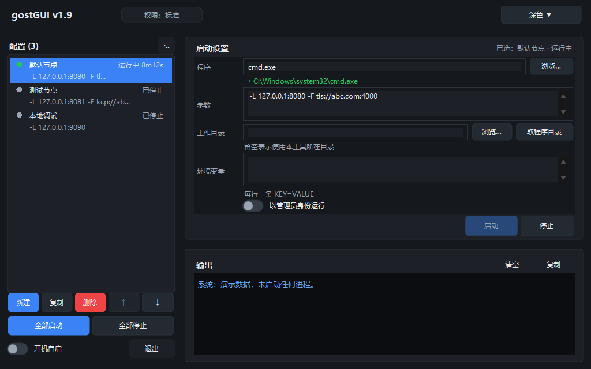
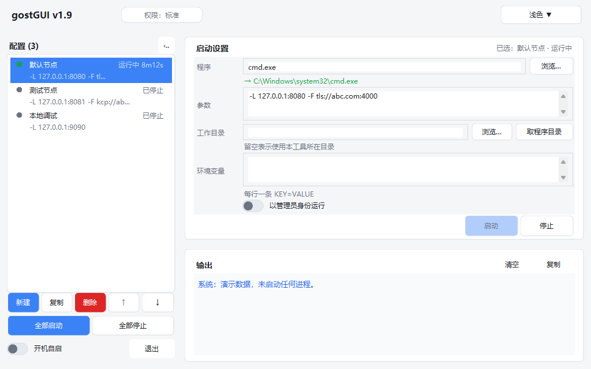
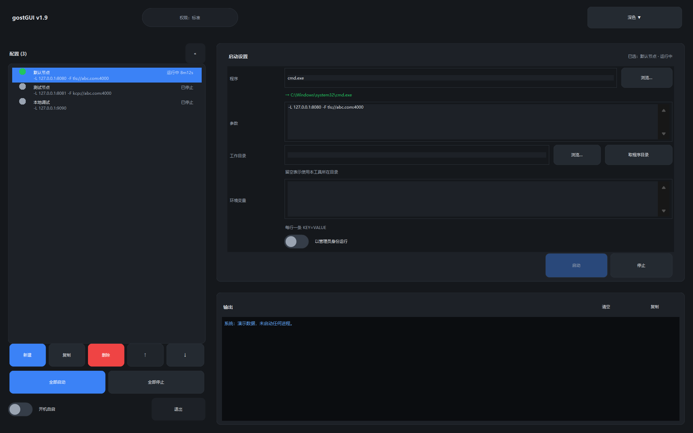

# gostGUI

A GUI tool to run terminal programs (for example `gost.exe`) on Windows.  
No need to install the program as a service.  
It just runs silently in the background.

### Feature

- **Multi-Process Management**: Run and manage several command-line applications simultaneously, each with its own configuration.
- **Persistent Configurations**: All configurations are saved to a `config.json` file and reloaded on startup.
  - Add, copy, delete, rename, and reorder configurations on the fly.
  - Edit the program, arguments, working directory, and environment variables of each item.
- **Per-item launch settings**:
  - **Working directory** (`workDir`): empty means the folder containing `gostGUI.exe`; supports `%VAR%` and relative paths.
  - **Environment variables** (`env`): incremental overrides merged over the parent process environment, with `%VAR%` expansion (e.g. `PATH=%PATH%;C:\tools`).
  - **Bare command names**: `program` may be `gost` or `git`; resolved in the application folder and then the effective `PATH`, with `PATHEXT` completion (`.COM;.EXE;.BAT;.CMD`). Quoted paths, relative paths, and `%VAR%` are supported.
  - **Dual privilege model**: admin items are elevated explicitly, and items launched while gostGUI itself is elevated are de-elevated to the shell token (see [Privilege model](#privilege-model)).
- **Process Control**:
  - Start and Stop individual processes.
  - Start All / Stop All with a single click.
  - **全部启动** force-enables **every** item (including items whose `enable` is `false`, and disabled admin items) and then starts all of them. Because it also starts admin items, it may raise one UAC prompt per admin item. Startup auto-restore and Windows autostart are the **only** paths that filter by `enable`.
  - The `Enable` flag records "running / was running" and decides what startup auto-restore and Windows autostart start — **not** what 全部启动 starts. Items marked **run as administrator** are skipped by startup auto-restore and by Windows autostart; only an explicit Start / Start All asks for UAC.
- **Robust Operation**:
  - Child processes run silently in the background without a visible console window.
  - **Automatic Cleanup**: All managed child processes are automatically terminated when gostGUI exits, even if it crashes, preventing orphaned processes.
- **User-Friendly Interface**:
  - **Deep / light themes**: follows the system by default and can be switched (system / light / dark) from the top bar; the choice is persisted in `config.json`.
  - **DPI aware**: PerMonitorV2; crisp at 100% / 125% / 150% / 200% scaling.
  - **Per-item logs**: every item has its own log with three colours (stdout / stderr / system) and a 1000-line cap.
  - **System Tray Integration**: Minimizes to the system tray to stay out of your way. Includes a tray icon context menu for quick access to major functions (Start All, Stop All, Exit).
  - **Live Status Indicators**: A status dot and running time in the list show the current state of each process.
  - **Easy Configuration**: Drag-and-drop or browse for the executable file path.
- **Windows Integration**:
  - Option to automatically start with Windows.

### Screen

The committed snapshots below are rendered off-screen by the hidden `--ui-snapshot <dir>` switch (it never shows a window).

| Dark theme (96 DPI) | Light theme (96 DPI) |
|---|---|
|  |  |

| 150% scaling (144 DPI simulated, dark) | 200% scaling (native 192 DPI, dark) |
|---|---|
|  |  |

### 代码结构

源码按职责分目录；`gostGUI.sln` 是权威解决方案入口（VS18 的 `gostGUI.slnx` 是它的镜像，两者包含相同的 UI + Runner 两个工程）：

- `Form/`：`FormMain` 的 partial 拆分（配置列表、详情编辑器、日志面板、托盘/退出、启动、窗口状态、主题、快照），每个文件只负责一块界面职责。
- `Native/`：按 DLL 收口的 P/Invoke 声明与互操作结构体（kernel32 / user32 / advapi32 / dwmapi / shell32 / uxtheme）。
- `SelfTest/`：隐藏 `--selftest` 套件的 partial 拆分，按领域组织用例、断言与夹具（当前 130 个用例，全部通过时进程退出码为 0）。
- `Shared/`：UI 与 Runner 两个进程共享编译的代码（IPC 帧、启动 spec、环境块、Job 对象，以及 `ChildKind` / `IsExternalInit` 等共享类型）。
- `Theme/`：主题化控件、调色板与主题管理器（按钮、输入框、列表、菜单渲染等）。
- 根目录文件：主窗体骨架（`FormMain.cs` / `FormMain.Designer.cs`）、数据与进程层（`Common` / `ConfigurationManager` / `ProcessManager`）、权限与中转（`ElevationManager` / `RunnerClient`）、启动管线（`LaunchPipeline` / `ProgramResolver` / `WindowGeometry`）、日志与入口（`LogKind` / `LogViewManager` / `Program.cs`）。

### How to use

- Place `gostGUI.exe`, `gostGUI.exe.config`, `gostGUI.Runner.exe`, `gostGUI.Runner.exe.config`, and `config.json` in the same folder (see [Packaging](#packaging)).
- Select a program (full path, bare command name, or drag-and-drop) and type its arguments.
- Optionally set a working directory and environment variables for that item.
- Press **启动** to start it. Enable **以管理员身份运行** for programs that need elevation.
- **全部启动** force-enables and starts **every** item, including disabled ones; admin items then prompt once each, so it may raise several UAC prompts.
- Closing the window hides it to the tray; use the tray **退出** to quit.

### Configuration (`config.json`)

`gostGUI` saves its settings in a `config.json` file in the same directory. All fields added in v1.9 are optional: an old v1.8 file (only `autoRun` / `name` / `enable` / `program` / `args`) loads with default values and behaves exactly as before.

| Field | Type | Default | Semantics |
|---|---|---|---|
| `autoRun` | `bool` | `false` | Register gostGUI to start with Windows. |
| `theme` | `string` | `"system"` | `system` \| `light` \| `dark`. Invalid values fall back to `system`. |
| `window` | `object` | `{w:1024,h:640,x:-1,y:-1,max:false,dpi:96}` | Window geometry stored in **DIP**; `x`/`y` of `-1` lets Windows choose. `dpi` records the DPI at capture time. |
| `items[].name` | `string` | — | Unique display name of the item. |
| `items[].enable` | `bool` | `false` | "Running / was running". Startup auto-restore and Windows autostart start only enabled items; **全部启动** ignores this flag and force-enables + starts **every** item. |
| `items[].program` | `string` | `null` (未设置) | Full path or bare command name. Resolved as described in the feature list. `null`/absent means no program is configured and the item cannot start. |
| `items[].args` | `string` | `null` (未设置) | Command-line arguments, passed verbatim. `null`/absent means no arguments (not an empty argument list). |
| `items[].workDir` | `string` | `""` | Working directory. **Empty = the folder containing gostGUI.exe.** Supports `%VAR%` and paths relative to the application folder. |
| `items[].env` | `object` | `null` (absent) | Incremental overrides merged **over the parent environment** (case-insensitive). Values support `%VAR%`. `null`/absent means no overrides. |
| `items[].runAsAdmin` | `bool` | `false` | Run the item elevated (see [Privilege model](#privilege-model)). |

Notes:

- The merged environment block must stay below the Windows 32 KB limit; otherwise the item is refused with an error.
- `.bat` / `.cmd` files are launched through `cmd.exe /d /s /c`; an item-level `COMSPEC` override drives that wrapper.

### Privilege model

| gostGUI itself | `runAsAdmin` | How the item is launched |
|---|---|---|
| Standard user | `false` | Directly, inside the UI process (v1.8 behaviour). |
| Standard user | `true` | `gostGUI.Runner.exe` is started through `ShellExecuteEx` with the `runas` verb. |
| Elevated | `false` | The runner is started with the interactive shell's (`explorer.exe`) token, so the child is de-elevated to the shell token. |
| Elevated | `true` | Directly; the launcher already has the rights. |

- **One UAC prompt per admin item**; prompts cannot be merged. The runner holds the pipes, so admin items still stream real-time stdout/stderr, can be stopped, and are cleaned up with the process tree.
- Cancelling UAC logs `已取消管理员授权` in that item's log; nothing starts and gostGUI does not crash.
- A failed elevation or de-elevation is reported as an error. gostGUI **never** silently falls back to inheriting the launcher's privileges; if de-elevation is impossible, the log explicitly tells you to run gostGUI as a standard user instead.
- Admin items are excluded from startup auto-restore and Windows autostart. They get exactly one line in their own log — `已跳过：需要管理员权限，请手动启动` — and no prompt is shown; **全部启动** still force-enables and starts them (one prompt each).
- `GOSTGUI_FORCE_RUNNER=1` forces every item through the relay (same integrity, plain `CreateProcess`) to test the runner path without UAC.

### Packaging

A release consists of:

- `gostGUI.exe` + `gostGUI.exe.config` (UI)
- `gostGUI.Runner.exe` + `gostGUI.Runner.exe.config` (relay)
- `config.json`

A clean **Rebuild** (`MSBuild gostGUI.sln /t:Rebuild /p:Configuration=Release`) is required to produce this set. Incremental builds may legitimately leave package DLLs in `bin\Release` (Fody's up-to-date check skips Costura's CopyLocal filtering); those loose DLLs are not part of a release. The build copies **both** runner files next to the UI exe and fails if either is missing, so a packaging regression cannot pass silently.

### Change log

- **未发布**：
  - 修复：停止直连配置项时只结束了根进程，`.bat/.cmd` 拉起的子进程（`node` 等）会留成孤儿，占着端口/文件导致再次启动冲突。现在每个配置项各有一个 Job Object，停止即结束这一项的整棵进程树；根进程自己退出时也会带走它残留的子孙进程（口径与中转路径一致）。各项之间仍互不连坐。
- **v1.9**:
  - 新增每项独立工作目录：空值表示本工具所在目录，支持 `%VAR%` 与相对路径。
  - 新增每项环境变量：在父进程环境之上增量覆盖，支持 `%VAR%`，`PATH=%PATH%;C:\tools` 这类写法直接可用。
  - `Program` 支持 PATH/PATHEXT 裸命令解析（`gost` → `gost.exe`），并支持引号、相对路径与 `%VAR%`；界面实时显示解析结果。
  - 双向权限模型：普通权限下管理员项经中转进程显式提权（每项一次 UAC，可取消）；本工具以管理员启动时，非管理员项经 shell 令牌降权运行；提权/降权失败一律报错，绝不静默继承管理员权限。
  - 全新深/浅主题界面（默认跟随系统，可手动切换并持久化）、DPI 感知、每项独立日志（三色、1000 行上限、批量刷新）。
  - 启动时的自动恢复与开机自启不再拉起管理员项，只在该项日志写 `已跳过：需要管理员权限，请手动启动`；"全部启动"仍会逐项请求 UAC。
  - 发布形态为两个 exe（各自带 `.exe.config`）+ `config.json`；必须用 Rebuild 产出，增量构建可能残留打包 dll。
  - 内部结构现代化：`FormMain` 与 `SelfTest` 按职责拆分为 partial 文件，P/Invoke 收口到 `Native/`；除“退出时保存/提交失败现在必定显形（托盘退出模态框、系统关机气泡）”和“直连子进程停止会等到子进程真正退出后才报告完成”这两处修正外，其余均为结构变化，无行为变化。
  - 已知限制：
    - 停止进程时，子进程已经产生但尚未派发到界面的尾部输出可能被丢弃（直连与中转路径都可能）。
    - 子进程输出按 UTF-8 解码，非 UTF-8 输出会出现替换字符。
    - UAC 无法合并：一次"全部启动"里若有多个管理员项，会连续弹多次。
    - 降权启动依赖交互式 shell 的 `explorer.exe` 令牌；没有可用 shell 令牌时会报错而不会降级。
    - `.ps1` 不支持直接解析，请用 `powershell -File` 启动。
    - 项级 `COMSPEC` 覆盖会驱动 `.bat/.cmd` 的包装解释器。
  - 主窗口标题为 `gostGUI v1.9`，两个 exe 的版本均为 `1.9.0.0`（产品版本 `1.9`）。
- **v1.8**:
  - 允许在进程运行状态下直接重命名左侧列表显示名称，将界面显示与配置对象引用解耦（无需额外增加冗余 key 字段）。
  - 优化托盘双击与前台激活机制，移除易引发跨线程死锁的 `AttachThreadInput`，采用安全的 `keybd_event` 与 `TopMost` 机制，保证被其他窗口遮挡时可靠置顶且绝不死锁。
  - 修复多处极端情况下的程序卡死与界面冻结问题：
    - 日志追加改用非阻塞 `BeginInvoke`，避免后台进程输出日志时阻塞工作线程与主线程死锁。
    - 日志行数检测改用原生 Win32 `EM_GETLINECOUNT` 消息，消除原 `TextBox.Lines.Length` 频繁分配大数组导致的严重界面卡顿。
    - `ProcessManager` 内部多进程集合全面增加线程同步锁，避免并发修改导致 `Dictionary` 损坏或死循环卡死。
    - 增加 `config.json` 写入线程锁，避免并发保存产生文件读写冲突。
  - 程序主窗口标题更新为 `gostGUI v1.8`，程序集与文件版本升级至 `1.8`。
- **v1.6**: Click listbox to start/stop program.
- **v1.5**: Implemented robust multi-process management and automatic child-process cleanup on exit. Revamped UI with custom-drawn status icons and improved in-place editing. (Thanks to Gemini Code Assist).
- **v1.2**: Added "Run on system startup" functionality.
- **v0.1**: Initial release with support for multiple argument configurations.
